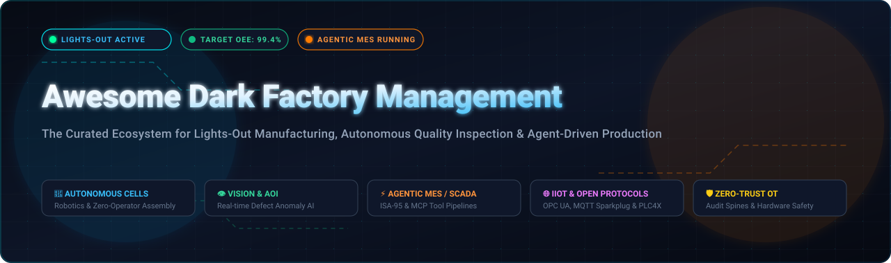
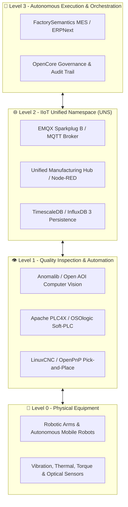

# 🏭 Awesome Dark Factory Management

**A Curated Index of SaaS Platforms & Open-Source Software for Autonomous Production, Lights-Out Operations, and Agentic MES**

*Optimized for Industrial IoT, Unattended Manufacturing Cells, Machine Vision AOI, and Zero-Operator Factory Floors*

---

## 📑 Table of Contents

- [🌟 Overview & SEO Taxonomy](#-overview--seo-taxonomy)
- [📊 Sector Overview & Market Dynamics](#-sector-overview--market-dynamics)
- [🏢 SaaS & Hosted Enterprise Platforms](#-saas--hosted-enterprise-platforms)
- [💻 Open-Source Projects & Frameworks](#-open-source-projects--frameworks)
- [🏗️ Blueprint Architecture for a Self-Hosted Dark Factory](#️-blueprint-architecture-for-a-self-hosted-dark-factory)
- [🤝 How to Contribute](#-how-to-contribute)
- [⚠️ Safety & Industrial Disclaimers](#️-safety--industrial-disclaimers)
- [⭐ Star History](#--star-history)
- [💖 Support](#-support)

---

## 🌟 Overview & SEO Taxonomy

A **Dark Factory** (also known as a **Lights-Out Factory**, **Unattended Facility**, or **Fully Autonomous Manufacturing Cell**) operates continuously with zero or near-zero human operators on the shop floor. Achieving true lights-out manufacturing requires the orchestration of five foundational digital and physical layers:

1. 🤖 **Autonomous Workcells & Robotics**: Robotic arms, collaborative cobots, and AGVs/AMRs executing continuous material handling and assembly.
2. 👁️ **Automated Optical Inspection (AOI) & Computer Vision**: High-speed, edge-deployed AI models performing defect detection, surface quality verification, and statistical process control in real time.
3. ⚡ **Agent-Native Manufacturing Execution Systems (MES)**: Autonomous software coordinating ISA-95 dispatching, PackML state transitions, ISO 22400 OEE computation, and closed-loop tool calls via protocols like Model Context Protocol (MCP).
4. 🌐 **Industrial IoT (IIoT) & Unified Namespace (UNS)**: Deterministic communication brokers routing sensor telemetry over OPC UA, MQTT Sparkplug B, and Modbus.
5. 🛡️ **Zero-Trust OT Infrastructure & Audit Spines**: Hardened, auditable access layers guaranteeing fail-safe isolation, compliance, and deterministic emergency stop procedures.

---

## 📊 Sector Overview & Market Dynamics

The global **Dark Factory and Lights-Out Manufacturing market** is valued at approximately **$138.7 billion to $143.6 billion in 2026**, on track to reach over **$280 billion by 2033** with a compound annual growth rate (CAGR) surpassing 10.4%. Concurrently, the broader **Smart Manufacturing and Industrial 4.0 software ecosystem** exceeds **$450 billion** globally, driven by chronic shortages of skilled industrial labor, surging wage inflation, and relentless demand for 24/7 defect-free throughput.

From a competitive standpoint, the sector is characterized by a **hybrid market structure**:
- **Moderately Concentrated at the Enterprise Platform Level**: Core industrial automation suites and centralized data foundations exhibit oligopolistic dominance. Industrial conglomerates (e.g., Schneider Electric / AVEVA, Rockwell Automation, Siemens, and Honeywell) leverage high switching costs and mission-critical multi-plant SLAs to consolidate large factory footprints.
- **Highly Fragmented across Machine Vision, IIoT Edge Connectors, and Specialized AI**: Defect inspection, agentic robotics, SMT line monitoring, and frontline video copilot niches remain intensely fragmented. Innovative startups and specialized open-source frameworks rapidly contest the shop floor by providing transparent APIs, open data standards, and modular edge-native deployments.

---

## 🏢 SaaS & Hosted Enterprise Platforms

The table below catalogs leading commercial SaaS solutions designed for dark factory operations, ranked in **descending order by company scale (Valuation / Revenue)**.

| SaaS Platform 🏢 | Company Size (Valuation / Revenue) 📈 | Starting Price 💳 | Free Tier / Trial Limits ⏱️ | Core Autonomous & Dark Factory Capabilities ⚙️ |
|:---|:---|:---|:---|:---|
| **[Cognite Data Fusion](https://www.cognite.com/)** | **$3.1B Valuation** (Acquired by Schneider Electric, 2026) / **$170M+ ARR** | Starts at ~$8,333/mo ($100,000/yr base platform contract via AWS/Azure private offer) | No self-serve free tier; 30-day guided enterprise sandbox / PoC environment upon qualification | Industrial DataOps platform unifying OT/IT/ET into contextualized knowledge graphs with Atlas AI copilots for automated production tuning. |
| **[Plex Systems](https://www.plex.com/)** | **$2.22B Valuation** (Acquired by Rockwell Automation) / **$150M+ ARR** | Starts at ~$500/user/mo (or entry production deployments starting at ~$3,000/mo, annual commitment) | No self-serve free tier; custom pilot sandbox & guided product walkthrough for qualified manufacturing plants | Cloud-native ERP & Smart Manufacturing MES providing real-time line telemetry, automated machine work-queues, and automated quality tracking. |
| **[Tulip Interfaces](https://tulip.co/)** | **$1.3B Valuation** (Unicorn status; $291M total funding) / **$60M+ ARR** | Starts at $100/interface/mo (Essentials plan, billed annually at $1,200/interface/yr; min. 5 interfaces) | 30-day free trial with full access to no-code app builder, Tulip Player, and sandbox runtime for up to 5 devices | Frontline operations and no-code shop floor engine integrating vision inspection, machine triggers, edge sensors, and headless workstation apps. |
| **[Bright Machines](https://www.brightmachines.com/)** | **~$750M Valuation** ($640M+ raised) / **$40M–$50M ARR** | Starts at ~$150,000/line/yr (Brightware software subscription + robotic cell deployment fees) | No self-serve free tier; structured digital microfactory simulation & live ROI line evaluation | Software-defined microfactories combining modular robotics, adaptive motion vision, and automated cell balancing for lights-out electronics assembly. |
| **[StrongDM](https://www.strongdm.com/)** | **~$400M Valuation** (Acquired by Delinea, $111M raised) / **$30M ARR** | Starts at $50/user/mo (Zero Trust Infrastructure Access SKU, billed annually) | 14-day free trial with unrestricted access to connect databases, clusters, and servers with full audit replay | Zero Trust Privileged Access Management (PAM) securing unattended remote OT/IT access, jump-hosts, and PLC programming terminals with immutable session recording. |
| **[Instrumental](https://instrumental.com/)** | **~$250M Valuation** ($81M+ raised, Series C) / **$20M–$28M ARR** | Starts at ~$4,166/mo ($50,000/yr base Trace platform + $2,500/mo/station hardware capture) | No self-serve free tier; 30-day NPI (New Product Introduction) proof-of-concept pilot on active lines | Real-time AI computer vision and visual inspection pipeline that intercepts manufacturing defects and correlates assembly telemetry across electronics lines. |
| **[Arch Systems](https://archsys.io/)** | **~$175M Valuation** ($45M+ raised, Series B) / **$5M–$10M ARR** | Starts at ~$2,500/machine/yr (ArchFX edge IoT broker connector + cloud operational intelligence) | No self-serve free tier; 30-day plant pilot deployment across up to 10 machines upon engineering qualification | Industrial IoT machine telemetry platform delivering real-time predictive OEE, SMT analytics, and autonomous action recommendations via ArchFX. |
| **[Augmentir](https://www.augmentir.com/)** | **~$60M Valuation** ($13.5M raised, Series A) / **$4M–$6M ARR** | Starts at $10/user/mo (Core frontline license) scaling to $45/user/mo for AI-guided workflows | No self-serve free tier; 14-day guided enterprise sandbox / pilot available upon sales verification | AI-native connected worker platform offering automated skill matrix tracking, guided digital checklists, and autonomous Kaizen anomaly identification. |
| **[Drishti](https://drishti.com/)** | **~$50M Valuation** (Acquired by Apple, $37M raised) / **$5M–$10M ARR** (pre-acquisition) | Starts at ~$1,500/camera stream/mo (B2B enterprise line monitoring subscription) | No self-serve free tier; production-line pilot evaluation conducted with OEM engineering teams | Action-recognition computer vision platform that converts video feeds of manual and hybrid assembly cells into structured statistical process control data. |
| **[Retrocausal](https://retrocausal.ai/)** | **~$25M Valuation** ($15.9M raised) / **$5M–$12M ARR** | Starts at ~$1,200/workstation/mo (Assembly Copilot AI license, annual commitment) | No self-serve free tier; interactive live pilot demonstration & Kaizen ROI diagnostic evaluation | Computer vision AI copilot and workstation auditor preventing assembly mistakes in real-time through audio-visual feedback and automated cycle analytics. |

---

## 💻 Open-Source Projects & Frameworks

Open-source technologies form the backbone of modern, vendor-independent dark factories. The curated repositories below are equipped with live Stars_Badges and sorted in **descending order of GitHub_Stars**.

1. 📦 **[ERPNext](https://github.com/frappe/erpnext)**   
   Full-featured, open-source ERP system featuring an extensive **Manufacturing & MES module** (license: GPL-3.0). Automates production order scheduling, nested multi-level Bills of Materials (BOM), work order routing, job card assignment, and capacity planning.

2. 🔀 **[Node-RED](https://github.com/node-red/node-red)**   
   Low-code visual programming tool for event-driven industrial applications (license: Apache-2.0). Connects shop-floor hardware, industrial PLCs, and cloud APIs with drag-and-drop nodes supporting OPC UA, Modbus, MQTT, and Siemens S7.

3. 📊 **[ThingsBoard](https://github.com/thingsboard/thingsboard)**   
   Open-source IoT platform for device telemetry collection, processing, and real-time visualization (license: Apache-2.0). Provides rule-engine automation, device digital twinning, alarms, and MQTT/CoAP/HTTP device connectivity for factory telemetry.

4. 📡 **[EMQX](https://github.com/emqx/emqx)**   
   Ultra-scalable open-source MQTT platform for IIoT and connected vehicles (license: Apache-2.0). Supports 100M+ concurrent MQTT connections, sub-millisecond latency, and native Sparkplug B compliance for building resilient Unified Namespaces (UNS).

5. 🖼️ **[Albumentations](https://github.com/albumentations-team/albumentations)**   
   High-performance image augmentation library (license: MIT) widely deployed across manufacturing inspection pipelines to boost deep learning model accuracy in surface defect classification and optical sorting.

6. 🔍 **[Anomalib](https://github.com/open-edge-platform/anomalib)**   
   Deep learning anomaly detection library for industrial quality inspection (license: Apache-2.0). Implements state-of-the-art algorithms (PatchCore, PaDiM, Reverse Distillation) for zero-shot and few-shot unsupervised visual defect detection.

7. 🔌 **[open62541](https://github.com/open62541/open62541)**   
   Open-source C implementation of OPC UA (OPC Unified Architecture) under Mozilla Public License v2.0. Highly optimized for embedded microcontrollers, edge gateways, and real-time PLCs requiring secure M2M industrial communication.

8. ⚙️ **[LinuxCNC](https://github.com/LinuxCNC/linuxcnc)**   
   Real-time motion control system for CNC mills, lathes, 3D printers, laser cutters, and robotic arms (license: GPL-2.0). Coordinates up to 9 axes of motion with PREEMPT_RT or RTAI kernel integration for deterministic machining.

9. 🎯 **[OpenPnP](https://github.com/openpnp/openpnp)**   
   Open-source software for pick-and-place surface mount technology (SMT) assembly machines (license: GPL-3.0). Uses computer vision for fiducial alignment, nozzle calibration, and autonomous electronic component placement.

10. 🏭 **[Apache PLC4X](https://github.com/apache/plc4x)**   
    Universal protocol adapter library for industrial PLCs (license: Apache-2.0). Reads and writes machine state across Siemens S7, Beckhoff ADS, Modbus, Allen-Bradley EtherNet/IP, and Omron Fins without requiring proprietary drivers.

11. ☕ **[Eclipse Milo](https://github.com/eclipse-milo/milo)**   
    Pure Java open-source implementation of OPC UA client and server stacks (license: EPL-2.0). Extensively utilized in enterprise Java MES, SCADA bridges, and industrial microservices.

12. 📋 **[qcadoo MES](https://github.com/qcadoo/mes)**   
    Open-source web manufacturing execution system tailored for small and medium manufacturing enterprises (license: AGPL-3.0). Covers production scheduling, bill of materials, inventory management, and workstation order fulfillment.

13. 🎛️ **[JSON-SCADA](https://github.com/riclolsen/json-scada)**   
    Portable, scalable SCADA, IIoT, and Industry 4.0 data platform running in an all-in-one Docker stack (license: Apache-2.0). Features MongoDB, PostgreSQL/TimescaleDB, Grafana, OPC UA, DNP3, IEC 60870-5-104, and MQTT Sparkplug B.

14. 🌐 **[Unified Manufacturing Hub](https://github.com/united-manufacturing-hub/united-manufacturing-hub)**   
    Open-source toolkit and reference architecture for Industrial IoT and Unified Namespaces (license: Apache-2.0). Features OPC UA to MQTT gateways, PackML line simulators, and Kafka/MQTT data broker connectors.

15. 🧠 **[Industrial-ML](https://github.com/YKatser/Industrial-ML)**   
    Curated repository of industrial machine learning cases, open manufacturing benchmark datasets, academic papers, and anomaly detection codebases for predictive maintenance and process optimization.

16. ⚡ **[Eclipse 4diac IDE](https://github.com/eclipse-4diac/4diac-ide)**   
    Open-source integrated development environment for distributed industrial control systems based on the IEC 61499 standard (license: EPL-2.0). Enables vendor-independent, event-driven control logic across multi-vendor PLCs.

17. 🔬 **[Open AOI](https://github.com/ChrnyaevEK/open-aoi)**   
    Automated Optical Inspection software for industrial camera feeds. Features intuitive graphical inspection configuration, template matching, edge verification, and defect alarms.

18. 🤖 **[FactorySemantics MES](https://github.com/factorysemantics/factorysemantics-mes)**   
    Modular, **agent-native Manufacturing Execution System** (license: Apache-2.0) built on ISA-95, PackML, and ISO 22400 KPIs. Integrates REST and Model Context Protocol (MCP) tool calls, append-only audit spines, and deterministic plant simulation over OPC UA.

19. 🕹️ **[OSOlogic Platform](https://github.com/OSOlogic/platform)**   
    Open-source software PLC platform (license: AGPL-3.0) turning any microcontroller (RP2040, STM32, ESP32) or Linux PC into a real-time programmable logic controller accessible via SQL, REST, and OPC UA.

20. 🌾 **[Agrync](https://github.com/ManuelMuRodriguez/Agrync)**   
    Open-source industrial IoT gateway unifying Modbus, OPC UA, and FIWARE protocols into a centralized web dashboard; validated on 1,200+ continuous sensor data points in production agro-industrial facilities.

21. 🔒 **[OpenCore MES](https://github.com/opencore-mes/opencore-mes)**   
    Low-code MES engine designed for advanced manufacturing up to 300mm semiconductor fabs (license: Apache-2.0). Features mandatory Design &rarr; Review &rarr; Approval &rarr; Execution workflows backed by hash-chained audit trails.

22. 📈 **[InfluxDB 3 IIoT Reference Architecture](https://github.com/influxdata/influxdb3-ref-iiot)**   
    Runnable automotive plant simulation (1 plant &times; 3 lines &times; 8 stations = 24 machines streaming ~300 points/sec) showcasing time-series ingestion, andon dashboards, and real-time Python analytics.

23. 💎 **[Carbon MES](https://github.com/PabloOyarzo/carbon)**   
    Modern full-stack manufacturing ERP/MES/QMS suite built with Remix, TypeScript, Supabase, and Tailwind (license: AGPL-3.0). Supports nested BoMs, real-time database subscriptions, and MCP server endpoints.

---

## 🏗️ Blueprint Architecture for a Self-Hosted Dark Factory

To assemble a resilient, vendor-independent, fully open-source dark factory management stack:

- **Execution & Orchestration**: Deploy **FactorySemantics MES** or **ERPNext** alongside **OpenCore MES** for agent-driven scheduling, MCP tool pipelines, and policy approval gates.
- **Unified Namespace (UNS)**: Route all plant state through **EMQX** and **Unified Manufacturing Hub**, caching real-time metrics with **TimescaleDB** or **InfluxDB**.
- **Defect Detection**: Position **Anomalib** on edge accelerators (Intel OpenVINO / NVIDIA Jetson) for millisecond optical inspection.
- **Machine Interface**: Bridge legacy and modern controllers with **Apache PLC4X** and **open62541**.

---

## 🤝 How to Contribute

Contributions from manufacturing engineers, software architects, and industrial automation practitioners are warmly welcomed! 🌟

1. 🍴 **Fork the repository**.
2. 🌿 **Create a topic branch**: `git checkout -b feature/add-new-tool`.
3. 📝 **Add or update an entry**:
   - For **SaaS**: Include product name, hyperlinked official website, specific starting price, explicit free tier / trial limits, company valuation/revenue scale, and a concise technical description.
   - For **Open-Source**: Provide the GitHub repo URL, the live Shields.io Stars_Badge (`?style=social&color=white`) linking to `/stargazers`, license type, and technical highlights. Sort by stars descending.
4. 🚀 **Submit a Pull Request** with a brief summary of why the tool is essential for dark factory management.

---

## ⚠️ Safety & Industrial Disclaimers

> [!IMPORTANT]
> **Safety Regulations**: Dark factory implementations controlling physical equipment must strictly adhere to industrial safety standards, including **OSHA**, **ISO 13849** (Safety of Machinery - Safety-related parts of control systems), and **IEC 61508** (Functional Safety). Software-driven emergency stops (E-stops) must never replace physical, hardware-interlocked safety relays.

> [!WARNING]
> **Emerging Open-Source Maturity**: While open-source MES and IIoT tools are advancing rapidly, end-to-end autonomous orchestration requires careful integration testing. Always validate agentic decision-making, automated tool invocations, and PackML state transitions in simulated environments (such as deterministic CI digital twins) prior to commissioning live manufacturing equipment.

---

##  Star History

---

## 💖 Support

A huge thank you to everyone exploring, testing, and advancing autonomous dark factory ecosystems! 🙌

If you find this repository valuable, please consider supporting it:
- ⭐ **Star this repository** to help others discover it across GitHub.
- 🍴 **Fork and contribute** your tools, architectures, and benchmarks.
- 📢 **Share this guide** with colleagues, manufacturing engineers, and automation teams.
- ☕ **Buy a coffee & sponsor** ongoing research and maintenance via the [GitHub Sponsors Dashboard](https://github.com/sponsors/ishandutta2007).

